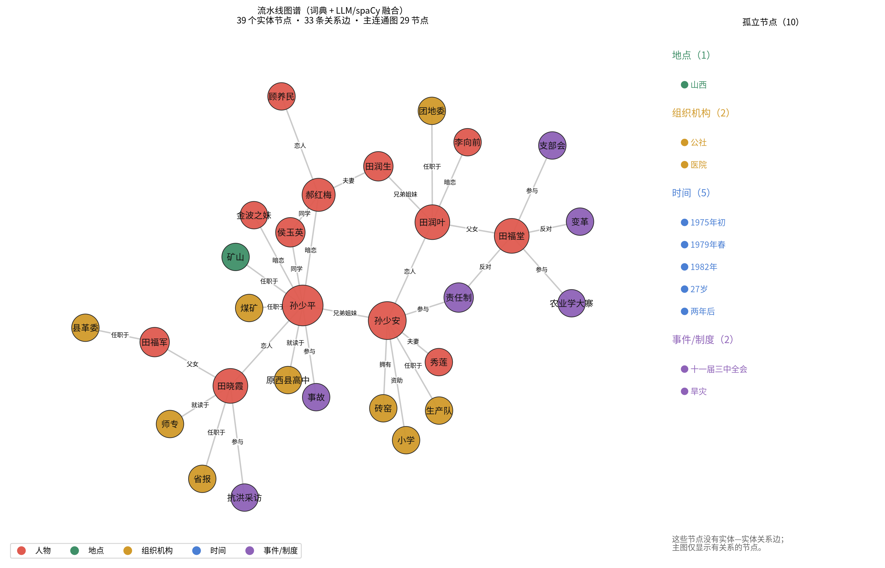

# 平凡的世界 · 中文信息抽取与知识图谱流水线

把《平凡的世界》三部梗概，做成一条可复现的中文信息抽取 + 知识图谱流水线：

**三篇文本 → 实体词典/金标准 → BERT / BiLSTM-CRF / LLM 实体抽取 → spaCy / BERT / LLM 关系抽取 → Neo4j / LLM 知识图谱 → 对比报告**

## 结果速览



| 任务 | 方法 | P | R | F1 |
|---|---|---:|---:|---:|
| 实体 | **LLM 零样本** | 0.9800 | 0.9245 | **0.9515** |
| 实体 | BERT 微调 | 0.8158 | 0.5849 | 0.6813 |
| 实体 | BiLSTM-CRF | 0.6296 | 0.3208 | 0.4250 |
| 关系 | **LLM** | 0.9722 | 0.9459 | **0.9589** |
| 关系 | spaCy 规则 | 1.0000 | 0.8378 | 0.9118 |
| 关系 | BERT 句对分类 | 0.0870 | 0.0541 | 0.0667 |
| 图谱 | Neo4j（词典 + LLM/spaCy 融合） | 0.9697（关系） | 0.9697 | 0.9697 |
| 图谱 | LLM 端到端 | 0.8684（关系） | 1.0000 | 0.9296 |

- 语料：3 篇、24 句、77 个 mention、39 个规范实体、33 条唯一关系。
- 实体评估：文档级 `(规范名, 类型)`，53 个“文档—实体”对。
- 关系评估：doc 级 37 条金标准；全局去重后 33 条。
- Neo4j：39 节点、33 关系边、53 条 `MENTIONS`，导入 2.53 s，数据库约 1.08 MiB。
- LLM 图谱：44 节点、38 边，端到端生成 53.96 s；召回 100%，但多出 5 个背景节点/边。

## 快速开始

```bash
git clone https://github.com/your-name/novel-kg-pipeline.git
cd novel-kg-pipeline
pip install -r requirements.txt
python -m spacy download zh_core_web_sm

# 1) 生成金标准与实体词典
python src/pipeline.py prepare

# 2) 实体抽取（BERT + BiLSTM；LLM 结果已缓存）
python src/pipeline.py entities

# 3) 关系抽取（spaCy + BERT；LLM 结果已缓存）
python src/pipeline.py relations

# 4) 构建 Neo4j 图谱（需先启动 Neo4j）
python src/pipeline.py kg

# 或全量一条命令（BERT 关系约 22 min）
python src/pipeline.py all
```

冒烟模式（2 折、少轮数，不用于最终指标）：

```bash
python src/pipeline.py all --fast
python src/pipeline.py all --skip-bert
```

### Neo4j 启动

```bash
sudo -u neo4j env NEO4J_CONF=/etc/neo4j /usr/share/neo4j/bin/neo4j start
# 默认连接：bolt://localhost:7687，用户 neo4j，密码 kgNeo4j2026
# 可用环境变量覆盖：NEO4J_URI / NEO4J_USER / NEO4J_PASSWORD
```

安装与配置详见 `docs/05_流水线复现.md`；也可直接把 `outputs/kg_pipeline.cypher` 拖进 Neo4j Browser 执行。

## 目录结构

```
novel-kg-pipeline/
├─ data/
│  ├─ raw/                 # doc1.txt / doc2.txt / doc3.txt
│  └─ annotated/           # gold.json / 实体词典 / LLM 缓存
├─ src/
│  ├─ schema.py            # 5 类实体、14 类关系、别名、金标准三元组
│  ├─ make_gold.py         # 最长匹配生成 span 与词典
│  ├─ bert_ner.py          # BERT-BIO 实体
│  ├─ bilstm_crf.py        # BiLSTM-CRF 实体
│  ├─ spacy_re.py          # spaCy 依存 + 占位符规则
│  ├─ bert_re.py           # BERT 句对关系分类
│  ├─ evaluate.py          # 统一 P/R/F1
│  ├─ kg_quality.py        # 图谱质量/结构统计
│  ├─ kg_neo4j.py          # Neo4j 导入 + Cypher + 压测
│  └─ pipeline.py          # 一条命令流水线
├─ prompts/                # LLM 抽取提示词
├─ outputs/                # 预测、指标、Cypher、图谱 JSON
├─ docs/                   # 5 份实验报告
├─ tests/                  # 轻量单元测试（CI 可跑）
└─ .github/workflows/ci.yml
```

## 文档

| 文档 | 内容 |
|---|---|
| [`docs/01_实体词典.md`](docs/01_实体词典.md) | 39 个实体、别名、词频、释义 |
| [`docs/02_实体抽取对比.md`](docs/02_实体抽取对比.md) | BERT / LLM / BiLSTM-CRF 指标与错误分析 |
| [`docs/03_关系三元组.md`](docs/03_关系三元组.md) | spaCy / BERT / LLM + 33 条融合三元组 |
| [`docs/04_知识图谱对比.md`](docs/04_知识图谱对比.md) | Neo4j vs LLM 的质量、查询、构建对比 |
| [`docs/05_流水线复现.md`](docs/05_流水线复现.md) | 环境、命令、输出、Neo4j 配置 |
| [`REPORT.md`](REPORT.md) | 01–05 合并版总报告（可直接提交） |

## 关键文件

- 金标准：`data/annotated/gold.json`
- 实体词典：`data/annotated/entity_dictionary.csv`
- 融合三元组：`outputs/kg_pipeline.json`
- Neo4j Cypher：`outputs/kg_pipeline.cypher`
- 图谱指标：`outputs/kg_metrics.json`
- LLM 图谱：`outputs/kg_llm.json`

## 方法要点

1. **实体评估口径**：文档级规范名 + 类型；别名先归一；`TP+FN=53`，不是 mention 数 77。
2. **BiLSTM-CRF 修复**：CRF `forward` 返回正 NLL，训练时不能取负；加入 BIO 合法转移约束与 0.8×加权交叉熵。
3. **spaCy 规则**：实体占位符 + 负向前瞻，解决分词切碎实体与跨实体误配；精确率 1.0，跨句/代词是主要漏项。
4. **BERT 关系**：37 个正例、14 类关系，样本严重不足；7 条跨句金标准无法挂到单句，评估必计 FN。
5. **图谱 schema**：缺少 `发生于` / `位于` 等时空边，导致 10–13 个时间/地点/事件节点孤立；这是下一步扩展点。
6. **Neo4j vs JSON**：39 节点小图上 JSON 进程内扫描更快（µs 级），Neo4j 3–5 ms 含 Bolt/事务开销；规模上 10^4–10^5 节点时 Neo4j 索引与 Cypher 才有优势。

## 测试

```bash
pip install -r requirements-ci.txt
pytest -q
```

CI 覆盖别名归一、对称/有向三元组键、实体/关系指标、图谱孤立节点统计；不依赖 torch / spaCy / Neo4j。

## 局限

- LLM 结果为会话内缓存，未接线上 API；`prompts/` 提供同口径提示词，便于替换为任意 OpenAI-compatible 模型。
- 语料只有 24 句，监督模型指标不能代表更大规模数据上的表现。
- LLM 图谱包含 5 个小说背景知识节点/边，报告中单独标注，不与“可溯源抽取”混淆。
- Neo4j 查询压测在 2 核 / 3.9 GB 的 CPU 云主机上完成，绝对值随硬件变化。

## License

MIT
