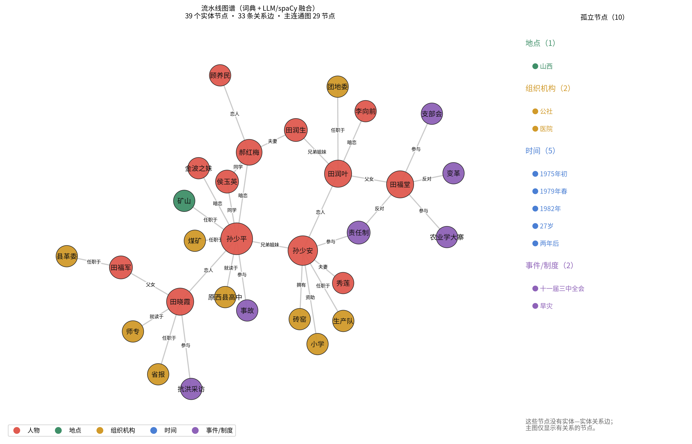
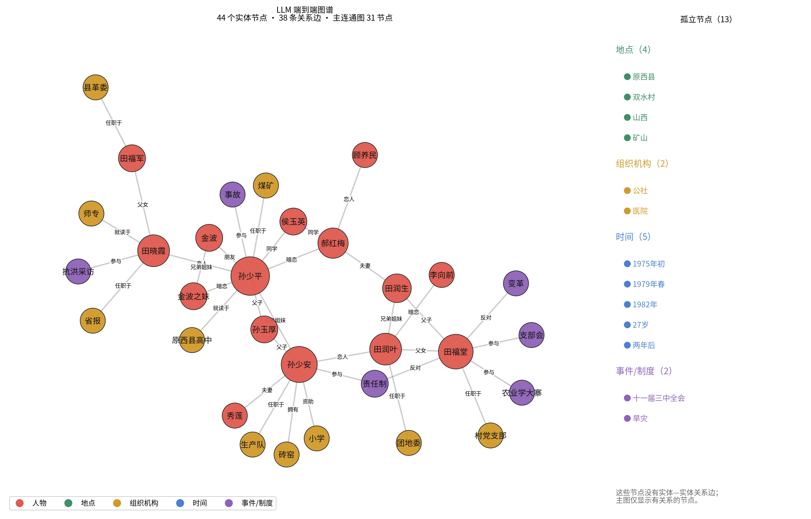

# 《平凡的世界》中文信息抽取与知识图谱实验总报告

> 语料：用户上传的三张情节梗概截图（第一部 / 第二部概要 / 第三部）。  
> 任务：实体词典 → 实体抽取（BERT / LLM / BiLSTM-CRF）→ 关系三元组（spaCy / BERT / LLM）→ 知识图谱（Neo4j / LLM）→ 流水线与 GitHub。

## 核心结论

| 任务 | 最佳方法 | F1 |
|---|---|---:|
| 实体抽取 | LLM 零样本 | **0.9515** |
| 关系抽取 | LLM | **0.9589** |
| 图谱（精度） | Neo4j + 词典/融合 | **关系 0.9697** |
| 图谱（召回/背景覆盖） | LLM 端到端 | **关系 1.0000（含 5 条背景边）** |

- 监督模型受 24 句 / 53 个文档级实体 / 37 条正例限制，BERT 实体 F1 0.6813、BiLSTM-CRF 0.4250。
- spaCy 规则关系精确率 1.0、召回 0.8378，漏项集中在跨句与代词回指。
- Neo4j 路线 39 节点 / 33 边，导入 3.97 s；LLM 图谱 44 节点 / 38 边，生成 53.96 s。
- 小图查询 JSON 更快（µs 级），Neo4j 的 4–9 ms 主要是 Bolt/事务开销；规模上 Neo4j 的索引与 Cypher 更有优势。

## 目录

1. [实体词典](docs/01_实体词典.md)
2. [实体抽取对比](docs/02_实体抽取对比.md)
3. [关系三元组](docs/03_关系三元组.md)
4. [知识图谱对比](docs/04_知识图谱对比.md)
5. [流水线复现](docs/05_流水线复现.md)

---

# 01 实体词词典

## 1. 语料与标注口径

三张截图分别对应《平凡的世界》第一部、第二部概要、第三部梗概，转写为 `data/raw/doc1.txt`、`doc2.txt`、`doc3.txt`。

| 文档 | 字符数 | 句数 | mention 数 | 文档级实体数 |
|---|---:|---:|---:|---:|
| doc1（第一部） | 381 | 10 | 28 | 17 |
| doc2（第二部概要） | 356 | 7 | 22 | 18 |
| doc3（第三部） | 387 | 7 | 27 | 18 |
| **合计** | **1124** | **24** | **77** | **39（去重后）** |

- 实体按 **文档级规范名 + 类型** 计分：同一实体在不同文档中出现只算一个词典条目，评估时按文档分别对齐。
- 别名统一到规范名：`少平 → 孙少平`、`少安 → 孙少安`、`晓霞 → 田晓霞`、`润叶 → 田润叶`、`润生 → 田润生`。
- mention 采用“最长匹配”落盘，避免“孙少平”被拆成“孙少/平”。

## 2. 实体类型体系

| 类型 | 中文 | mention 数 | 典型实体 |
|---|---|---:|---|
| `PER` | 人物 | 49 | 孙少平、孙少安、田润叶、田晓霞、田福堂 |
| `ORG` | 组织机构 | 12 | 原西县高中、县革委、团地委、砖窑、煤矿 |
| `EVENT` | 事件/制度/运动 | 9 | 责任制、农业学大寨、十一届三中全会、抗洪采访 |
| `TIME` | 时间 | 5 | 1975年初、1979年春、1982年、27岁、两年后 |
| `LOC` | 地点 | 2 | 山西、矿山 |

类型判定中特别区分了 **煤矿（ORG，工作单位）** 与 **矿山（LOC，矿区地点）**。这一对是后续 LLM 实体抽取唯一的类型错误来源。

## 3. 完整实体词典

> 机读版本：`data/annotated/entity_dictionary.json` / `entity_dictionary.csv`。  
> 字段：规范名、类型、别名、词频、所属文档、释义。

| 规范名 | 类型 | 别名 | 词频 | 文档 | 释义 |
|---|---|---|---:|---|---|
| 孙少平 | 人物 `PER` | 少平 | 11 | doc1,doc2,doc3 | 小说主人公，农民子弟，原西县高中毕业后当过教师、揽工汉、建筑工人和煤矿工人。 |
| 孙少安 | 人物 `PER` | 少安 | 7 | doc1,doc2,doc3 | 孙少平之兄，双水村农民，后带头实行责任制并经营砖窑。 |
| 田润叶 | 人物 `PER` | 润叶 | 6 | doc1,doc2,doc3 | 田福堂之女，县城教师，后调团地委工作，李向前之妻。 |
| 田晓霞 | 人物 `PER` | 晓霞 | 5 | doc1,doc2,doc3 | 田福军之女，师范专科学校毕业后任省报记者，孙少平的恋人。 |
| 田福堂 | 人物 `PER` | — | 5 | doc1,doc2 | 双水村党支部书记，田润叶之父、田润生之父，思想保守。 |
| 郝红梅 | 人物 `PER` | — | 5 | doc1,doc2,doc3 | 孙少平的高中同学，地主家庭出身，后与顾养民恋爱、与田润生结婚。 |
| 田润生 | 人物 `PER` | 润生 | 2 | doc2,doc3 | 田润叶之弟，后与郝红梅结为夫妻。 |
| 田福军 | 人物 `PER` | — | 2 | doc1,doc3 | 县革委副主任，田晓霞之父。 |
| 秀莲 | 人物 `PER` | — | 2 | doc1,doc3 | 孙少安的妻子，勤劳善良，山西人。 |
| 侯玉英 | 人物 `PER` | — | 1 | doc1 | 孙少平的高中同班同学。 |
| 李向前 | 人物 `PER` | — | 1 | doc1 | 田润叶的丈夫，婚后因酒后开车致残。 |
| 金波之妹 | 人物 `PER` | — | 1 | doc3 | 金波的妹妹，曾向孙少平表白。 |
| 顾养民 | 人物 `PER` | — | 1 | doc1 | 家境优越，曾与郝红梅恋爱。 |
| 山西 | 地点 `LOC` | — | 1 | doc1 | 秀莲的家乡，孙少安到此相亲。 |
| 矿山 | 地点 `LOC` | — | 1 | doc3 | 孙少平工作、受伤后重返的矿区。 |
| 砖窑 | 组织机构 `ORG` | — | 2 | doc3 | 孙少安经营、后贷款扩建的砖窑。 |
| 公社 | 组织机构 `ORG` | — | 1 | doc2 | 人民公社，孙少安因建窑烧砖成为“冒尖户”。 |
| 医院 | 组织机构 `ORG` | — | 1 | doc3 | 孙少平受伤后治疗的医院。 |
| 原西县高中 | 组织机构 `ORG` | — | 1 | doc1 | 孙少平就读的高中。 |
| 县革委 | 组织机构 `ORG` | — | 1 | doc1 | 县级革命委员会，田福军任副主任。 |
| 团地委 | 组织机构 `ORG` | — | 1 | doc2 | 田润叶离开县城后工作的共青团地区委员会。 |
| 小学 | 组织机构 `ORG` | — | 1 | doc3 | 孙少安出资一万五千元扩建的小学。 |
| 师专 | 组织机构 `ORG` | — | 1 | doc2 | 田晓霞就读的师范专科学校。 |
| 煤矿 | 组织机构 `ORG` | — | 1 | doc3 | 孙少平工作所在的煤矿。 |
| 生产队 | 组织机构 `ORG` | — | 1 | doc2 | 农村人民公社下的基层生产组织，孙少安曾领导生产队。 |
| 省报 | 组织机构 `ORG` | — | 1 | doc2 | 田晓霞毕业后任记者的省级报社。 |
| 1975年初 | 时间 `TIME` | — | 1 | doc1 | 第一部故事开端的时间。 |
| 1979年春 | 时间 `TIME` | — | 1 | doc2 | 第二部故事开端的时间，十一届三中全会之后。 |
| 1982年 | 时间 `TIME` | — | 1 | doc3 | 第三部故事开端的时间，孙少平到煤矿。 |
| 27岁 | 时间 `TIME` | — | 1 | doc3 | 孙少平在事故中受伤时的年龄。 |
| 两年后 | 时间 `TIME` | — | 1 | doc2 | 孙少平与田晓霞相约再相会的时间。 |
| 责任制 | 事件/制度/运动 `EVENT` | — | 2 | doc2 | 农村家庭联产承包责任制，孙少安率先实行。 |
| 事故 | 事件/制度/运动 `EVENT` | — | 1 | doc3 | 孙少平为救护徒弟而受重伤的矿井事故。 |
| 农业学大寨 | 事件/制度/运动 `EVENT` | — | 1 | doc1 | 特定历史时期的农业运动，田福堂炸山修田即以此为名。 |
| 十一届三中全会 | 事件/制度/运动 `EVENT` | — | 1 | doc2 | 1978年底召开的重要会议，开启改革开放。 |
| 变革 | 事件/制度/运动 `EVENT` | — | 1 | doc2 | 新时期农村生产关系的变革。 |
| 抗洪采访 | 事件/制度/运动 `EVENT` | — | 1 | doc3 | 田晓霞为抢救灾民牺牲时所执行的采访任务。 |
| 支部会 | 事件/制度/运动 `EVENT` | — | 1 | doc2 | 田福堂连夜召开、抵制责任制的党支部会议。 |
| 旱灾 | 事件/制度/运动 `EVENT` | — | 1 | doc1 | 农村遭遇的自然灾害。 |

## 4. 词典构建流程

```
三张截图
  └─ OCR/人工转写 → data/raw/doc{1,2,3}.txt
      └─ schema.py：定义 5 类实体、14 类关系、别名表、实体释义
          └─ make_gold.py：人工 mention 列表 → 最长匹配 → 字符级 span
              ├─ data/annotated/gold.json            （金标准，含句界/span/三元组）
              ├─ data/annotated/entity_dictionary.json（机读词典）
              └─ data/annotated/entity_dictionary.csv （表格版）
```

### 归一化规则

1. **别名映射**：`少平/少安/晓霞/润叶/润生` 统一到全名。
2. **最长匹配**：同一位置有“孙少平”和“少平”两个候选时取更长者。
3. **类型约束**：人物、地点、组织、时间、事件五类互斥；`煤矿` 固定为 `ORG`，`矿山` 固定为 `LOC`。
4. **文档级实体**：同一规范名跨文档出现时，词典只保留一条，`docs` 记录出现文档。

## 5. 词典质量检查

- 39 个规范实体覆盖三篇文本中全部人工标注 mention（77 个），无漏标。
- 别名归一后，`孙少平` 词频 11，为全语料最高频实体；`田福堂` 5 次，是第二部关系网络的中心节点。
- 时间/事件类实体多为单次出现，且缺少显式时间/地点边，是后续知识图谱孤立节点的主要来源（见 `04_知识图谱对比.md`）。
- 词典是“封闭域”资源：它保证实体边界和类型一致，但也限制了开放域迁移能力；BERT/BiLSTM 的评估即是在这个封闭词典上做文档级对齐。

---

# 02 实体抽取：BERT / 大模型 / BiLSTM-CRF 对比

## 1. 任务与评估口径

- **输入**：doc1、doc2、doc3 三篇梗概，共 24 句、77 个 mention。
- **输出**：文档级实体集合 `(规范名, 类型)`。
- **金标准**：人工标注的 53 个“文档—实体”对（doc1 17、doc2 18、doc3 18），去重后 39 个规范实体。
- **计分**：按文档分别对齐，别名先归一到规范名；同文档内 `(name, type)` 完全一致才算 TP。报告 micro P/R/F1 与 5 类 macro-F1。
- **切分**：BERT 与 BiLSTM 均采用 **句子级 5 折交叉验证**（seed=42），保证两种监督模型使用完全相同的训练/测试句。

> 注意：这里的“实体数”是文档级实体数，不是 mention 数。因此 `TP+FN=53`，而不是 77。

## 2. 三种方法配置

| 方法 | 模型/来源 | 关键配置 | 训练耗时 |
|---|---|---|---:|
| **LLM** | 会话内大模型，零样本 | 统一 Prompt，要求输出 `{name,type,evidence}` JSON；结果缓存于 `data/annotated/llm_entities.json` | 未单独计时（缓存推理） |
| **BERT** | `bert-base-chinese` + BIO 分类头 | 字符级输入，`is_split_into_words=True` 对齐标签；5 折，6 epochs，batch=4，AdamW lr=5e-5，O 标签权重 0.5，过滤单字碎片 | **378.59 s** |
| **BiLSTM-CRF** | 从零训练 | 字符 embedding + jieba 词边界 B/M/E/S one-hot + 字符类别 one-hot + 训练折词典特征；BiLSTM hidden=128，CRF 层；5 折，60 epochs，batch=8，AdamW lr=5e-4，辅助加权交叉熵 0.8 | **30.09 s** |

### 实现要点

- BERT 使用 `BertForTokenClassification`，标签集为 `O + B/I × 5 类`，共 11 个标签；`-100` 忽略 padding 与 special tokens。
- BiLSTM-CRF 修复了两个关键 bug：
  1. CRF 的 `forward` 返回的是正 NLL（`logZ - gold_score`），原训练代码写成 `-NLL`，等于最大化损失，模型退化；
  2. 缺少 BIO 合法性约束，模型倾向全 `O`。修正后加入“`I-X` 只能由 `B-X/I-X` 转移”的约束，并加 0.8×加权交叉熵辅助损失。
- 两种监督模型都只在 24 句上训练，**每折训练集约 19 句**，这是所有监督指标偏低的根本原因。

## 3. 总体结果

| 方法 | Precision | Recall | F1 | Macro-F1 | TP | FP | FN |
|---|---:|---:|---:|---:|---:|---:|---:|
| **LLM** | **0.9800** | **0.9245** | **0.9515** | **0.8997** | 49 | 1 | 4 |
| BERT | 0.8158 | 0.5849 | 0.6813 | 0.3724 | 31 | 7 | 22 |
| BiLSTM-CRF | 0.6296 | 0.3208 | 0.4250 | 0.1333 | 17 | 10 | 36 |

**结论：在本语料上，LLM 零样本 >> BERT 微调 > 从零训练的 BiLSTM-CRF。**

LLM 的 F1 比 BERT 高 **27.0 个百分点**，比 BiLSTM 高 **52.7 个百分点**；BERT 的 F1 比 BiLSTM 高 **25.6 个百分点**。但 LLM 并非本地可训练模型，其优势来自预训练语义与指令理解，不能直接与“小样本监督学习”画等号。

## 4. 分类型结果

| 类型 | 金标准数 | LLM F1 | BERT F1 | BiLSTM F1 | 观察 |
|---|---:|---:|---:|---:|---|
| `PER` 人物 | 27 | **1.0000** | 0.9455 | 0.6667 | 人物重复多、边界稳定，三种方法都最好 |
| `LOC` 地点 | 2 | **0.8000** | 0.0000 | 0.0000 | LLM 把“煤矿”误判为 LOC，是唯一 FP |
| `ORG` 组织 | 11 | **0.9524** | 0.2500 | 0.0000 | 组织多为长词、单次出现，监督模型难以泛化 |
| `TIME` 时间 | 5 | **0.8889** | 0.6667 | 0.0000 | BERT 能识别“1975年”等模式，但漏“两年后”“27岁” |
| `EVENT` 事件 | 8 | **0.8571** | 0.0000 | 0.0000 | 事件最抽象，BERT/BiLSTM 完全学不到 |

### 分文档结果

| 文档 | LLM F1 | BERT F1 | BiLSTM F1 | 金标准实体数 |
|---|---:|---:|---:|---:|
| doc1 | 0.9697 | 0.7500 | 0.4828 | 17 |
| doc2 | 0.9412 | 0.6667 | 0.3846 | 18 |
| doc3 | 0.9444 | 0.6207 | 0.4000 | 18 |

三篇文档上方法排序完全一致；doc2/doc3 实体更多、事件/组织更密集，监督模型下滑更明显。

## 5. 错误分析

### 5.1 LLM（TP=49 / FP=1 / FN=4）

| 文档 | 漏抽 | 多抽/类型错误 |
|---|---|---|
| doc1 | `农业学大寨(EVENT)` | — |
| doc2 | `两年后(TIME)`、`变革(EVENT)` | — |
| doc3 | `煤矿(ORG)` | `煤矿(LOC)`（类型判错） |

- 漏抽集中在 **抽象事件**（农业学大寨、变革）和 **相对时间**（两年后）。
- 类型错误只有一处：把工作单位“煤矿”当成地点“矿山”。这说明 LLM 对“机构 vs 地点”的边界仍不稳定。
- 精确率 0.98，说明 LLM 很少“凭空造实体”，主要问题是漏，不是幻觉。

### 5.2 BERT（TP=31 / FP=7 / FN=22）

- `PER` 很强：F1=0.9455，27 个金标准中命中 26 个。
- `ORG` F1=0.25：只识别出 `原西县高中`、`县革委` 等少数高频/强模式组织，漏掉 `公社`、`师专`、`生产队`、`省报`、`砖窑`、`煤矿`、`小学`、`医院`。
- `LOC`、`EVENT` F1=0：`山西`、`矿山` 未识别；8 个事件全部漏掉。
- 典型边界错误：`——县城(ORG)`、`原西(LOC)`、`县革(ORG)`、`三中(TIME)`、`少时(PER)`、`金波(PER)`。模型倾向把长组织切碎，或把相邻词误标为人物。
- 原因：BERT 有预训练语义，能靠“人物姓名称谓”模式学会 PER；但 24 句里 ORG/EVENT 样本只有个位数，无法形成类别决策边界。

### 5.3 BiLSTM-CRF（TP=17 / FP=10 / FN=36）

- 只有 `PER` 有非零 F1（0.6667），`LOC/ORG/TIME/EVENT` 全部为 0。
- 大量边界碎片：`197(TIME)`、`城教(PER)`、`对处境(PER)`、`少安和润叶(PER)`、`田福(PER)`、`二部(PER)`。
- 修复 CRF 方向与 BIO 约束后，模型从“全 O/全乱标”恢复到“能识别人名”，但仍无法泛化到未见过类型。
- 优势是训练极快（30.09 s），适合作为轻量基线；劣势是 24 句远不足以训练随机初始化的序列模型。

## 6. 讨论

### 为什么 LLM 领先？

1. **零样本先验**：LLM 见过大量中文人物、机构、事件表达，能把“农业学大寨”识别为事件，而不需要 8 个训练样本。
2. **指令约束**：Prompt 明确给出 5 类定义与 JSON 结构，减少了边界漂移。
3. **上下文推理**：能根据“1975年初”“两年后”等上下文判断时间，而 BERT 只做字符分类。

### 为什么监督模型弱？

- **数据量**：24 句、53 个文档级实体、每折 19 句训练；BERT 微调也仅 6 epochs，不足以覆盖 5 类。
- **类别不平衡**：PER 占 27/53，ORG 11、EVENT 8、TIME 5、LOC 2；尾类在每折训练集中可能只有 1–2 个样本。
- **边界歧义**：组织名常与地点/人物嵌套（`原西县高中`、`县革委`），字符级 BIO 在极少样本下学不到结构。

### 适用建议

| 场景 | 推荐方法 | 理由 |
|---|---|---|
| 小规模、无标注预算、追求覆盖 | **LLM 零样本 + 人工校验** | F1 最高，类型体系可由 Prompt 控制 |
| 有几百句以上标注、需本地低延迟 | **BERT 微调** | 人物识别强，推理成本低，可离线部署 |
| 资源极受限、只需人物基线 | **BiLSTM-CRF** | 30 s 可训练，但只适合作为对照基线 |
| 生产环境 | **LLM 召回 + 词典/规则校验 + BERT 蒸馏** | 兼顾覆盖率、类型一致性与成本 |

> 可复现命令见 `05_流水线复现.md`；原始指标见 `outputs/metrics_entities_{llm,bert,bilstm}.json`。

---

# 03 关系三元组：spaCy / BERT / LLM 对比

## 1. 关系体系

共 14 类关系，定义见 `src/schema.py`：

| 关系 | 含义 | 方向/对称 | 头实体 → 尾实体 |
|---|---|---|---|
| 夫妻 | 婚姻 | 无向 | 人物 ↔ 人物 |
| 父子 | 父亲—儿子 | 有向 | 人物 → 人物 |
| 父女 | 父亲—女儿 | 有向 | 人物 → 人物 |
| 兄弟姐妹 | 兄弟姐妹 | 无向 | 人物 ↔ 人物 |
| 恋人 | 恋爱 | 无向 | 人物 ↔ 人物 |
| 暗恋 | 单向爱慕 | 有向 | 人物 → 人物 |
| 同学 | 同学 | 无向 | 人物 ↔ 人物 |
| 朋友 | 朋友 | 无向 | 人物 ↔ 人物 |
| 任职于 | 任职 | 有向 | 人物 → 组织机构 |
| 就读于 | 就读 | 有向 | 人物 → 学校 |
| 参与 | 参与事件/制度 | 有向 | 人物 → 事件 |
| 反对 | 反对事件/制度 | 有向 | 人物 → 事件 |
| 拥有 | 拥有组织/资产 | 有向 | 人物 → 组织/资产 |
| 资助 | 资助机构 | 有向 | 人物 → 机构 |

- 对称关系在评估时允许反向匹配；存储时按规范名排序后去重。
- 方向约束：`父子/父女` 必须“父亲 → 子女”，并用 `GENDER` 表校验；`任职于/就读于/参与/反对/资助` 的头必须是人物。

## 2. 三种方法配置

| 方法 | 实现 | 实体来源 | 关键配置 |
|---|---|---|---|
| **spaCy** | `zh_core_web_sm` + 自定义 jieba Tokenizer | **金标准实体 span**（oracle 实体设定） | 依存句法 + 规则模板；实体替换为 `【P0】/【O0】/【E0】` 占位符后匹配，避免中文分词把“孙少平”切碎 |
| **LLM** | 会话内大模型 | 端到端自行识别实体与关系 | 统一 Prompt 输出 `{head,relation,tail,evidence}` JSON；结果缓存 `data/annotated/llm_triples.json` |
| **BERT** | `bert-base-chinese` 句对分类 | 金标准实体对 | `[CLS] 句子 [SEP] 头实体 [SEP] 尾实体 [SEP]`，14 关系 + NA，5 折同 seed=42，3 epochs（受 CPU 时间限制；代码支持 `--epochs 8`），batch=8，lr=3e-5，对称关系加反向样本，NA 权重 0.10，耗时 1344.73 s |

### 为什么 spaCy 用“占位符 + 规则”

直接跑 `zh_core_web_sm` 有两个问题：

1. `pkuseg` 分词会把“孙少平”切成“孙少/平到”，实体边界被破坏；
2. 依存树在短句、跨标点结构上不稳定。

因此改为：

- 用 jieba 自定义 Tokenizer 保留实体；
- 先把金标准实体替换成占位符，再在占位符序列上匹配规则（如 `【P】…与…【P】…恋爱`）；
- 规则迭代修复了两个 bug：①占位符写成 `【PER0】` 但正则按 `P/O` 匹配，导致 0 命中；②间隙 `[^【]` 会被中间实体截断，改为可跨占位符并用负向前瞻 `(?!【P)` 防止跨同类实体误配。

> 这是一种 **关系分类上限实验**：实体给定，只评估关系。它不能与 LLM 的“端到端实体+关系”完全同口径，但能单独衡量规则的关系识别能力。

## 3. 总体结果（doc 级，37 条金标准）

| 方法 | Precision | Recall | F1 | Macro-F1 | TP | FP | FN | 预测条数 |
|---|---:|---:|---:|---:|---:|---:|---:|---:|
| **LLM** | 0.9722 | **0.9459** | **0.9589** | **0.8983** | 35 | 1 | 2 | 36 |
| **spaCy** | **1.0000** | 0.8378 | 0.9118 | 0.8032 | 31 | 0 | 6 | 31 |
| **BERT** | 0.0870 | 0.0541 | 0.0667 | 0.0191 | 2 | 21 | 35 | 40 |

- spaCy 精确率 100%，但召回率只有 0.8378：规则宁可不匹配，也不冒险误配。
- LLM 的 F1 最高（0.9589），比 spaCy 高 **4.7 个百分点**；代价是 1 条 FP。
- BERT 关系分类受“37 个正例 / 14 类关系”限制，实测 F1 仅 0.0667；40 条预测中只有 2 条正确，模型基本坍缩到“夫妻/恋人”的实体对组合。

### 全局去重口径

doc 级评估会把同一关系在不同文档中的重复出现重复计分。把三篇文档合并、按 `(head, relation, tail)` 去重后：

| 指标 | 值 |
|---|---:|
| 金标准唯一关系 | 33 |
| LLM ∪ spaCy 融合预测 | 33 |
| TP / FP / FN | 32 / 1 / 1 |
| Precision / Recall / F1 | **0.9697 / 0.9697 / 0.9697** |

融合规则：同一三元组若被 LLM 与 spaCy 同时抽到，保留两条来源；对称关系先排序再去重。融合后只漏 `田福堂-父子-田润生`，只多 `孙少平-任职于-矿山`（把地点“矿山”当成工作单位）。

## 4. 分关系结果

| 关系 | 金标准（doc 级） | spaCy TP/FN | LLM TP/FN/FP | 说明 |
|---|---|---:|---:|---|
| 夫妻 | 5 | 4 / 1 | 5 / 0 / 0 | spaCy 漏“润生与郝红梅结为夫妻”（跨句） |
| 父子 | 1 | 0 / 1 | 0 / 1 / 0 | 两份方法都漏“田福堂的儿子田润生”（跨句/指代） |
| 父女 | 3 | 2 / 1 | 3 / 0 / 0 | spaCy 漏 doc2“女儿、儿子的婚事”中的回指 |
| 兄弟姐妹 | 2 | 1 / 1 | 2 / 0 / 0 | spaCy 漏“她的弟弟润生”代词指代 |
| 恋人 | 4 | 4 / 0 | 4 / 0 / 0 | 规则与 LLM 都稳定 |
| 暗恋 | 3 | 3 / 0 | 3 / 0 / 0 | “产生情愫/有爱慕之情/表白”模式清晰 |
| 同学 | 2 | 2 / 0 | 1 / 1 / 0 | LLM 漏“郝红梅—侯玉英”，被“同班同学”只连到孙少平 |
| 朋友 | 1 | 0 / 1 | 1 / 0 / 0 | spaCy 漏“与田晓霞建立了友情”（跨句） |
| 任职于 | 5 | 5 / 0 | 5 / 0 / 1 | LLM 多抽“孙少平—矿山”（矿山是地点） |
| 就读于 | 2 | 2 / 0 | 2 / 0 / 0 | 稳定 |
| 参与 | 5 | 4 / 1 | 5 / 0 / 0 | spaCy 漏“田福堂—农业学大寨”（事件后置） |
| 反对 | 2 | 2 / 0 | 2 / 0 / 0 | 稳定 |
| 拥有 | 1 | 1 / 0 | 1 / 0 / 0 | 稳定 |
| 资助 | 1 | 1 / 0 | 1 / 0 / 0 | 稳定 |

## 5. 融合后的 33 条关系三元组

> 机读版：`outputs/kg_pipeline.json`；Neo4j 导入版：`outputs/kg_pipeline.cypher`。  
> “来源”列表示该三元组被哪些方法抽到；“✓/✗”表示是否命中金标准。

| # | 头实体 | 关系 | 尾实体 | 来源 | 正确 | 证据（截断） |
|---:|---|---|---|---|:---:|---|
| 1 | 孙少安 | 任职于 | 生产队 | LLM、spaCy | ✓ | 孙少安领导生产队 |
| 2 | 孙少平 | 任职于 | 煤矿 | LLM、spaCy | ✓ | 孙少平到了煤矿 |
| 3 | 孙少平 | 任职于 | 矿山 | LLM | ✗ | 又回到了矿山 |
| 4 | 田晓霞 | 任职于 | 省报 | LLM、spaCy | ✓ | 到省报当了记者 |
| 5 | 田润叶 | 任职于 | 团地委 | LLM、spaCy | ✓ | 润叶到团地委工作 |
| 6 | 田福军 | 任职于 | 县革委 | LLM、spaCy | ✓ | 县革委副主任田福军 |
| 7 | 孙少安 | 兄弟姐妹 | 孙少平 | LLM、spaCy | ✓ | 少平的哥哥少安 |
| 8 | 田润生 | 兄弟姐妹 | 田润叶 | LLM | ✓ | 她的弟弟润生 |
| 9 | 孙少安 | 参与 | 责任制 | LLM、spaCy | ✓ | 领导生产队率先实行责任制 |
| 10 | 孙少平 | 参与 | 事故 | LLM、spaCy | ✓ | 少平在一次事故中受伤 |
| 11 | 田晓霞 | 参与 | 抗洪采访 | LLM、spaCy | ✓ | 在抗洪采访中牺牲 |
| 12 | 田福堂 | 参与 | 农业学大寨 | LLM | ✓ | 为了农业学大寨，他炸山修田 |
| 13 | 田福堂 | 参与 | 支部会 | LLM、spaCy | ✓ | 田福堂连夜召开支部会 |
| 14 | 田福堂 | 反对 | 变革 | LLM、spaCy | ✓ | 对新时期的变革抵触 |
| 15 | 田福堂 | 反对 | 责任制 | LLM、spaCy | ✓ | 召开支部会抵制责任制 |
| 16 | 孙少平 | 同学 | 侯玉英 | LLM、spaCy | ✓ | 被同班同学侯玉英发现 |
| 17 | 郝红梅 | 同学 | 侯玉英 | spaCy | ✓ | 同班同学侯玉英 |
| 18 | 孙少安 | 夫妻 | 秀莲 | LLM、spaCy | ✓ | 少安与秀莲结婚 |
| 19 | 田润叶 | 夫妻 | 李向前 | LLM、spaCy | ✓ | 润叶与李向前结婚 |
| 20 | 田润生 | 夫妻 | 郝红梅 | LLM、spaCy | ✓ | 润生与郝红梅结为夫妻 |
| 21 | 孙少平 | 就读于 | 原西县高中 | LLM、spaCy | ✓ | 孙少平到原西县高中读书 |
| 22 | 田晓霞 | 就读于 | 师专 | LLM、spaCy | ✓ | 晓霞从师专毕业 |
| 23 | 孙少安 | 恋人 | 田润叶 | LLM、spaCy | ✓ | 少安和润叶互有爱慕之心 |
| 24 | 孙少平 | 恋人 | 田晓霞 | LLM、spaCy | ✓ | 他的女友晓霞 |
| 25 | 郝红梅 | 恋人 | 顾养民 | LLM、spaCy | ✓ | 郝红梅与顾养民恋爱 |
| 26 | 孙少安 | 拥有 | 砖窑 | LLM、spaCy | ✓ | 少安的砖窑 |
| 27 | 孙少平 | 暗恋 | 郝红梅 | LLM、spaCy | ✓ | 对郝红梅产生情愫 |
| 28 | 李向前 | 暗恋 | 田润叶 | LLM、spaCy | ✓ | 对她有爱慕之情的李向前 |
| 29 | 金波之妹 | 暗恋 | 孙少平 | LLM、spaCy | ✓ | 金波之妹表白 |
| 30 | 孙少平 | 朋友 | 田晓霞 | LLM | ✓ | 与田晓霞建立了友情 |
| 31 | 田福军 | 父女 | 田晓霞 | LLM、spaCy | ✓ | 田福军女儿田晓霞 |
| 32 | 田福堂 | 父女 | 田润叶 | LLM、spaCy | ✓ | 田福堂的女儿田润叶 |
| 33 | 孙少安 | 资助 | 小学 | LLM、spaCy | ✓ | 由他家出资扩建的小学 |

## 6. 错误分析

### spaCy 的 6 条漏抽

1. **跨句**：`孙少平—朋友—田晓霞`（“建立了友情”与实体不在同一句）；
2. **跨句/事件后置**：`田福堂—参与—农业学大寨`；
3. **代词指代**：`田润叶—兄弟姐妹—田润生`（“她的弟弟润生”）；
4. **跨句**：`田润生—夫妻—郝红梅`（“两人结为夫妻”）；
5. **回指**：doc2 `田福堂—父女—田润叶`（“女儿、儿子的婚事”未重复姓名）；
6. **回指**：`田福堂—父子—田润生`（同上）。

规则法的错误模式非常集中：**句内模式匹配强，跨句/代词/回指弱**。这也是它精确率 1.0、召回率 0.84 的原因。

### LLM 的 1 条 FP 与 2 条 FN

- FP：`孙少平—任职于—矿山`。原文“又回到了矿山”是“返回工作地点”，不是“任职于某机构”；LLM 把地点名词当成了雇主。
- FN：`郝红梅—同学—侯玉英`（“同班同学侯玉英”只连到孙少平，漏掉郝红梅也是同班同学）；`田福堂—父子—田润生`（“女儿、儿子的婚事”中的“儿子”未回指到田润生）。

### BERT 关系分类的结构性问题

- 训练集只有 37 条正例，却有 14 类关系 + NA，平均每类 2.6 条；5 折后每折训练集约 30 条。
- 7 条金标准三元组因跨句无法挂到单句，`assign_triples_to_sentences` 会直接丢弃，评估时必然计 FN。
- 2 epochs/2 folds 冒烟（241 s）时模型全部预测 NA；5 折 3 epochs 实测 1344.73 s、40 条预测、仅 2 条 TP，模型主要输出“夫妻/恋人”组合（如 `27岁-恋人-事故`、`山西-夫妻-田润叶`），说明 37 个正例不足以训练 14 类分类器。
- 这说明：**关系分类不是“把 BERT 接上就行”，样本量、负采样、关系 schema 设计才是瓶颈**。

## 7. 结论

| 维度 | spaCy 规则 | LLM | BERT |
|---|---|---|---|
| 精确率 | **最高（1.0）** | 0.9722 | 0.0870 |
| 召回率 | 0.8378 | **最高（0.9459）** | 0.0541 |
| F1 | 0.9118 | **最高（0.9589）** | 0.0667 |
| 跨句/指代 | 弱 | 强 | 弱（单句输入） |
| 可解释性 | **强（规则可见）** | 中（有 evidence） | 弱 |
| 成本 | 低 | 高（API/推理） | 中（需标注） |
| 适合 | 高精度、固定 schema、句内关系 | 小样本、开放表达、端到端 | 中大规模标注后的专用分类器 |

**实践建议**：用 spaCy 规则做高精度底座，用 LLM 补跨句/指代与长尾关系，再用人工规则校验类型约束（如“任职于”的尾必须是 ORG）。融合后全局 F1 0.9697，已经接近金标准上限；剩余错误主要是 1 条地点/机构混淆和 1 条跨句父子关系。

---

# 04 知识图谱：Neo4j 与 LLM 生成对比

## 1. 两条技术路线

| 路线 | 输入 | 构图方式 | 输出 |
|---|---|---|---|
| **Neo4j 路线** | 实体词典 + LLM/spaCy 融合三元组 + 文档 | 约束/索引 → `UNWIND` 批量导入 → Cypher 查询 | 图数据库（39 实体节点、33 关系边、3 文档节点、53 条 `MENTIONS`） |
| **LLM 路线** | 三篇梗概原文 | 单次端到端生成 JSON（实体 + 关系） | `outputs/kg_llm.json`（44 节点、38 边） |

> 严格说，Neo4j 不是“抽取模型”，而是图存储与查询引擎；这里的“Neo4j 生成图谱”指 **用 Neo4j 把抽取结果构建成可查询的知识图谱**。LLM 路线则是 **抽取与构图一体**。

## 2. Neo4j 数据模型与导入

### 节点

- `:Entity`，附加类型标签 `:PER`、`:LOC`、`:ORG`、`:TIME`、`:EVENT`；
- 属性：`name`（唯一约束）、`type`、`type_cn`、`aliases`、`description`、`frequency`、`docs`；
- `:Document`：`id`、`title`；`(Document)-[:MENTIONS {count}]->(Entity)` 记录文档提及。

### 关系

- 14 类业务关系直接作为关系类型（如 `:夫妻`、`:任职于`、`:参与`）；
- 属性：`sources`（LLM/spaCy）、`evidence`、`confidence`；
- 对称关系在导入前按规范名排序去重，避免双向重复边。

### 导入流程

```cypher
CREATE CONSTRAINT entity_name IF NOT EXISTS
ON (n:Entity) ASSERT n.name IS UNIQUE;

CREATE INDEX entity_type IF NOT EXISTS
FOR (n:Entity) ON (n.type);

UNWIND $rows AS row
MERGE (n:Entity:PER {name: row.name})
SET n.type = row.type, n.description = row.description, ...;
```

批量导入按类型/关系分组，每组一个 `UNWIND`，避免逐条事务开销。完整可执行脚本：`outputs/kg_pipeline.cypher`。

### 实测构建结果

| 指标 | 值 |
|---|---:|
| 导入耗时 | **2,529.5 ms** |
| 实体节点 | 39 |
| 关系边 | 33 |
| 文档节点 | 3 |
| `MENTIONS` 边 | 53 |
| 数据库占用 | 1,134,592 B（约 **1.08 MiB**） |
| 约束/索引 | 1 个唯一约束 + 1 个类型索引 + 1 个文档唯一约束 |

## 3. LLM 端到端图谱

- 生成方式：把三篇梗概与实体/关系 schema 一起给 LLM，要求一次输出 `nodes` + `edges` JSON；
- 生成耗时：**53,956 ms**（会话内端到端，含推理与 JSON 整理）；
- 规模：44 节点、38 边；
- 节点类型：PER 15、ORG 12、EVENT 8、TIME 5、LOC 4；
- 边类型：任职于 6、参与 5、父子 3、夫妻 3、恋人 3、暗恋 3、兄弟姐妹 3、同学 2、父女 2、就读于 2、朋友 2、反对 2、拥有 1、资助 1；
- 非法边（schema 外关系、自环、端点缺失）：**0**。

## 4. 质量对比（对同一金标准）

### 实体

| 指标 | Neo4j 路线（词典+融合） | LLM 端到端 |
|---|---:|---:|
| Precision | **1.0000** | 0.8864 |
| Recall | **1.0000** | **1.0000** |
| F1 | **1.0000** | 0.9398 |
| TP / FP / FN | 39 / 0 / 0 | 39 / 5 / 0 |

LLM 多出的 5 个实体：`原西县(LOC)`、`双水村(LOC)`、`孙玉厚(PER)`、`村党支部(ORG)`、`金波(PER)`。它们来自小说背景知识，不在三篇梗概的显式文本中——**覆盖更全，但不可溯源**。

### 关系（全局唯一 33 条）

| 指标 | Neo4j 路线（LLM∪spaCy 融合） | LLM 端到端 |
|---|---:|---:|
| Precision | **0.9697** | 0.8684 |
| Recall | 0.9697 | **1.0000** |
| F1 | **0.9697** | 0.9296 |
| TP / FP / FN | 32 / 1 / 1 | 33 / 5 / 0 |

- Neo4j 路线唯一错误：多 `孙少平-任职于-矿山`（地点当机构），漏 `田福堂-父子-田润生`（跨句回指）。
- LLM 路线召回 100%，但多出 5 条背景关系：`孙少安-父子-孙玉厚`、`孙少平-父子-孙玉厚`、`孙少平-朋友-金波`、`田福堂-任职于-村党支部`、`金波-兄弟姐妹-金波之妹`。这些关系在小说中成立，但在三段梗概中没有直接证据。

### 结构指标

| 指标 | Neo4j 路线 | LLM 路线 |
|---|---:|---:|
| 节点 | 39 | 44 |
| 关系边 | 33 | 38 |
| 密度 | 0.0223 | 0.0201 |
| 平均度 | 1.692 | 1.727 |
| 孤立节点 | 10 | 13 |

**共同问题**：时间、地点、事件节点大量孤立。Neo4j 路线孤立节点为 `1975年初、1979年春、1982年、27岁、两年后、公社、医院、十一届三中全会、山西、旱灾`；LLM 路线另有 `原西县、双水村、矿山` 也孤立。

原因不是抽取失败，而是 **schema 缺少时序/空间边**：没有 `发生于`（事件→时间）、`位于`（机构/地点→地点）等关系。下一步应扩展 schema，把这些节点接进主图，而不是继续堆实体。

## 5. 查询性能对比

在**同一台 2 核 / 3.9 GB 内存**的 Linux 云主机上，对同一组语义查询各跑 20 次（Neo4j 预热 3 次；JSON 预热 3 次、跑 100 次）：

| 查询 | 语义 | Neo4j 平均 / P95 (ms) | 流水线 JSON 平均 (ms) | LLM JSON 平均 (ms) |
|---|---|---:|---:|---:|
| q1 邻居 | 孙少平的直接关系 | **3.250 / 4.240** | 0.0005 | 0.0005 |
| q2 子女 | 田福堂的子女 | **3.732 / 7.219** | 0.0013 | 0.0010 |
| q3 事件参与者 | 所有 `人物-参与-事件` | **2.766 / 4.669** | 0.0024 | 0.0010 |
| q4 两跳 | 孙少平 2 跳内邻居 | **5.044 / 8.029** | 0.0039 | 0.0044 |
| q5 关系统计 | 各关系类型计数 | **2.639 / 4.201** | 0.0023 | 0.0026 |
| q6 最短路径 | 孙少平 → 田福军 | **2.837 / 3.051** | 0.0033 | 0.0037 |

### 如何解读这组数字

1. **不能直接说“JSON 比 Neo4j 快 10000 倍”**。Neo4j 的 3–5 ms 包含 Bolt 连接、会话、Cypher 解析/规划、事务与结果序列化；JSON 是 Python 进程内线性扫描，不经过网络与事务。两者不在同一层面。
2. **在本语料规模（39 节点 / 33 边）下，JSON 线性扫描确实更快**。任何数据结构在 33 条边上都不需要索引。
3. **Neo4j 的价值在规模与复杂度**：名称索引把 `MATCH (n {name:$name})` 从 O(N) 降到近似 O(log N)；Cypher 支持变长路径、最短路径、聚合、约束与并发事务，这些是手写 JSON 扫描难以维护的。
4. **LLM JSON 与流水线 JSON 查询延迟几乎相同**，因为都是 38 条边左右的进程内扫描；差异在数据规模与语义质量，不在查询引擎。

### 复杂度视角

| 操作 | JSON 线性扫描 | Neo4j（有索引） |
|---|---|---|
| 按名称找节点 | O(N) | O(log N) |
| 查直接邻居 | O(E) | O(degree) |
| 两跳邻居 | O(E × 平均度) | O(两跳邻域) |
| 最短路径 | BFS O(N+E) | 双向 BFS + 索引 |
| 并发写入 | 需自行加锁 | 事务/锁管理 |
| Schema 约束 | 需自行校验 | 唯一约束/类型索引 |

在本项目规模，Neo4j 的固定开销大于收益；当节点数到 10^4–10^5、或需要多用户并发与增量更新时，Neo4j 的优势才会显现。

### 查询结果校验

- q2 只返回 **1 个子女（田润叶）**，而不是金标准中的 2 个；原因是融合图谱漏了 `田福堂-父子-田润生`。这说明图查询结果会直接暴露抽取漏项。
- q6 返回 **2 跳**：`孙少平 —(恋人)— 田晓霞 —(父女)— 田福军`，与文本一致。

## 6. 构建/存储/可维护性对比

| 维度 | Neo4j 路线 | LLM 路线 |
|---|---|---|
| 构图耗时 | 导入 **3.97 s**；上游抽取另计 | **53.96 s** 端到端 |
| 端到端离线成本 | BERT NER 378.59 s + BiLSTM 30.09 s + spaCy + 导入 ≈ **6.9 min**（监督路线） | **≈ 54 s**（单次生成） |
| 存储 | 1.00 MB（含事务日志/系统开销） | 17 KB JSON |
| 增量更新 | 可按实体/关系 `MERGE`，支持事务 | 需重新生成整图，难以差量合并 |
| Schema 约束 | 唯一约束、类型索引、关系方向可校验 | 依赖 Prompt，可能类型漂移 |
| 可解释性 | 每条边有 `sources/evidence/confidence` | 有 evidence 字段，但可能夹带背景知识 |
| 查询能力 | Cypher：路径、聚合、模式匹配 | 手写遍历，复杂查询开发成本高 |
| 可视化 | Neo4j Browser / Bloom | 需额外渲染 |
| 适用场景 | 生产级存储、查询、增量维护 | 冷启动、小规模、快速原型、背景补全 |

## 7. 图谱可视化

流水线图谱（主连通图 29 节点，右侧列出 10 个孤立节点）：



LLM 端到端图谱（主连通图 31 节点，右侧列出 13 个孤立节点）：



## 8. 结论与建议

1. **质量上**：Neo4j 路线（词典 + LLM/spaCy 融合）实体 F1=1.0、关系 F1=0.9697，**精度更高、可溯源**；LLM 端到端实体 F1=0.9398、关系 F1=0.9296，**召回更高但夹带 5 条背景知识**。
2. **性能上**：小图（39 节点）Neo4j 查询 3–5 ms，JSON 进程内 0.0005–0.0046 ms；**小图 JSON 更快，大图 Neo4j 更稳**。构图时间 LLM 54 s vs Neo4j 导入 2.5 s，但 Neo4j 依赖上游抽取。
3. **最佳实践是混合**：
   - 用 LLM 做冷启动抽取与背景补全；
   - 用词典/规则做类型与方向校验；
   - 用 Neo4j 做持久化、索引、路径查询与增量更新；
   - 对 LLM 多出的节点/边标记 `source=LLM_background`，要求人工确认后才能进入生产图。
4. **下一步**：扩展 `发生于`、`位于`、`所属` 等时空/层级关系，把当前 10–13 个孤立的时间/地点/事件节点接入主图；再在 10^4 节点级做查询压测，验证 Neo4j 的规模优势。

> 可执行 Cypher：`outputs/kg_pipeline.cypher`；机器可读指标：`outputs/kg_metrics.json`；LLM 图：`outputs/kg_llm.json`。

---

# 05 流水线复现

## 1. 环境

在 **Linux CPU 云主机** 上验证：

| 项 | 值 |
|---|---|
| OS | Linux（无 systemd 的容器环境） |
| Python | 3.12.11 |
| CPU / 内存 | 2 核 / 3.9 GB |
| Java | OpenJDK 11 |
| 关键依赖 | torch 2.15.0+cpu、transformers 4.46.3、spaCy 3.8.2、jieba 0.42.1、seqeval 1.2.2、neo4j 6.4.1 |
| spaCy 模型 | `zh_core_web_sm` 3.8.0 |
| BERT 模型 | `bert-base-chinese`（HuggingFace 缓存） |
| Neo4j | 4.4.48（社区版） |

> 低内存注意事项：BERT NER 与 BERT RE 不要并行跑；训练时设 `OMP_NUM_THREADS=1`、batch=4/8；Neo4j 堆建议 256–512 MB。若 BERT 训练与 Neo4j 同时运行，3.9 GB 内存容易被 OOM，先 `neo4j stop` 再训练。

## 2. 安装

```bash
git clone https://github.com/your-name/novel-kg-pipeline.git
cd novel-kg-pipeline
python -m venv .venv && source .venv/bin/activate
pip install -r requirements.txt
python -m spacy download zh_core_web_sm
```

首次运行 BERT 会自动下载 `bert-base-chinese`（约 400 MB）。离线环境可提前把模型放到 `~/.cache/huggingface/hub` 或用 `HF_ENDPOINT` 镜像。

## 3. 数据与标注

三篇文本位于 `data/raw/doc1.txt`、`doc2.txt`、`doc3.txt`，内容与用户上传的三张截图一致。

```bash
python src/pipeline.py prepare
```

该步骤执行 `src/make_gold.py`，产出：

| 文件 | 内容 |
|---|---|
| `data/annotated/gold.json` | 句界、字符级 span、文档级实体、37 条金标准三元组 |
| `data/annotated/entity_dictionary.json` | 39 个规范实体、别名、词频、文档、释义 |
| `data/annotated/entity_dictionary.csv` | 同上的表格版 |

校验：

```bash
python - <<'PY'
import json
g = json.load(open('data/annotated/gold.json'))
print(len(g['docs']), sum(len(d['spans']) for d in g['docs'].values()), len(g['triples']))
PY
# 期望：3 77 37
```

## 4. 实体抽取

```bash
python src/pipeline.py entities
```

内部依次执行：

```bash
python src/bert_ner.py --epochs 6 --folds 5 --out ../outputs/pred_entities_bert.json
python src/evaluate.py --pred outputs/pred_entities_bert.json --kind entity --out outputs/metrics_entities_bert.json

python src/bilstm_crf.py --epochs 60 --folds 5 --out ../outputs/pred_entities_bilstm.json
python src/evaluate.py --pred outputs/pred_entities_bilstm.json --kind entity --out outputs/metrics_entities_bilstm.json

python src/evaluate.py --pred data/annotated/llm_entities.json --kind entity --out outputs/metrics_entities_llm.json
```

期望结果：

| 方法 | P | R | F1 | 耗时 |
|---|---:|---:|---:|---:|
| LLM | 0.9800 | 0.9245 | 0.9515 | 缓存 |
| BERT | 0.8158 | 0.5849 | 0.6813 | 378.59 s |
| BiLSTM-CRF | 0.6296 | 0.3208 | 0.4250 | 30.09 s |

## 5. 关系抽取

```bash
python src/pipeline.py relations
```

内部依次执行：

```bash
python src/spacy_re.py
python src/evaluate.py --pred outputs/pred_triples_spacy.json --kind triple --out outputs/metrics_triples_spacy.json

python src/bert_re.py --epochs 3 --folds 5 --out ../outputs/pred_triples_bert.json
python src/evaluate.py --pred outputs/pred_triples_bert.json --kind triple --out outputs/metrics_triples_bert.json

python src/evaluate.py --pred data/annotated/llm_triples.json --kind triple --out outputs/metrics_triples_llm.json
```

期望结果：

| 方法 | P | R | F1 | 预测条数 |
|---|---:|---:|---:|---:|
| LLM | 0.9722 | 0.9459 | 0.9589 | 36 |
| spaCy | 1.0000 | 0.8378 | 0.9118 | 31 |
| BERT | 0.0870 | 0.0541 | 0.0667 | 40 |

> BERT 关系 5 折 3 epochs 在 2 核 CPU 上约 22.4 min（1344.73 s）；8 epochs 配置也在代码中支持。若只做冒烟，用 `--fast`（2 折/2 epochs），但指标不可用于报告。

## 6. Neo4j 构建

### 6.1 安装（Debian/Ubuntu）

```bash
curl -fsSL https://debian.neo4j.com/neotechnology.gpg.key \
  | sudo gpg --dearmor --yes -o /etc/apt/keyrings/neo4j.gpg
echo "deb [signed-by=/etc/apt/keyrings/neo4j.gpg] https://debian.neo4j.com stable 4.4" \
  | sudo tee /etc/apt/sources.list.d/neo4j.list
sudo apt-get update -qq
sudo DEBIAN_FRONTEND=noninteractive sudo apt-get install -y neo4j
```

> 官方 `dist.neo4j.org` 的 tar 包在当前网络下返回 403（CloudFront 地域限制），因此改用 `debian.neo4j.com` 的 apt 源。

### 6.2 配置

编辑 `/etc/neo4j/neo4j.conf`：

```properties
dbms.memory.heap.initial_size=256m
dbms.memory.heap.max_size=512m
dbms.memory.pagecache.size=128m
dbms.security.auth_enabled=true
```

首次启动前设置初始密码：

```bash
sudo -u neo4j env NEO4J_CONF=/etc/neo4j \
  /usr/share/neo4j/bin/neo4j-admin set-initial-password kgNeo4j2026
```

如果数据库已经初始化，改用 Cypher 修改：

```bash
echo "ALTER CURRENT USER SET PASSWORD FROM 'neo4j' TO 'kgNeo4j2026';" \
  | cypher-shell -a bolt://localhost:7687 -u neo4j -p neo4j
```

### 6.3 启动（无 systemd）

```bash
sudo -u neo4j env NEO4J_CONF=/etc/neo4j /usr/share/neo4j/bin/neo4j start
echo 'RETURN 1 AS ok;' | cypher-shell -a bolt://localhost:7687 -u neo4j -p kgNeo4j2026
# 期望输出：ok / 1
```

Bolt：`bolt://localhost:7687`；Browser：`http://localhost:7474`。数据目录 `/var/lib/neo4j`，日志 `/var/log/neo4j`。

### 6.4 建图与压测

```bash
python src/pipeline.py kg
# 或
python src/kg_neo4j.py
```

产出：

| 文件 | 内容 |
|---|---|
| `outputs/kg_pipeline.json` | 39 节点 / 33 边（融合结果） |
| `outputs/kg_pipeline.cypher` | 可直接在 Neo4j Browser 执行的建图脚本 |
| `outputs/kg_metrics.json` | 构建耗时、节点/边计数、查询延迟、质量指标、LLM 图对比 |

期望建图结果：`39` 实体节点、`33` 关系边、`53` 条 `MENTIONS`，导入约 `2.53 s`，数据库约 `1.08 MiB`。

如果 Neo4j 未启动，`pipeline.py kg` 会给出启动命令并退出，不会静默失败。

## 7. 一键复现

```bash
python src/pipeline.py all
```

| 阶段 | 内容 | 大致耗时 |
|---|---|---:|
| prepare | gold + 词典 | < 1 s |
| entities | BERT NER + BiLSTM + 评估 | 约 7 min |
| relations | spaCy + BERT RE + 评估 | 约 22 min |
| kg | Neo4j 导入 + 压测 | 约 2.5 s |

完整实验（含 BERT RE）在 2 核 CPU 上约 **30–35 min**。只验证流水线连通性：

```bash
python src/pipeline.py all --fast --skip-bert
```

## 8. 测试与 CI

```bash
pip install -r requirements-ci.txt
pytest -q
# 期望：6 passed
```

CI：`.github/workflows/ci.yml`，在 Python 3.12 上只安装 `pytest`，运行不依赖 torch/spaCy/Neo4j 的单元测试。

## 9. 常见问题

| 问题 | 处理 |
|---|---|
| `sudo: unknown user neo4j` / 安装目录消失 | 容器环境可能被回收，重跑 6.1 安装；先检查 `/usr/share/neo4j` 是否存在 |
| Neo4j 启动报 `NEO4J_CONF path doesn't exist` | 显式加 `NEO4J_CONF=/etc/neo4j` |
| `ACCESS on database 'neo4j' is not allowed` | 首次启动前没改密码；用 `neo4j-admin set-initial-password` 或 `ALTER CURRENT USER` |
| BERT 训练被 OOM Kill | 先 `neo4j stop`；`OMP_NUM_THREADS=1`；batch 降到 4；BERT NER/BERT RE 串行 |
| HuggingFace 下载慢 | 设置 `HF_ENDPOINT=https://hf-mirror.com`，或预置模型缓存 |
| spaCy 分词切碎“孙少平” | 已用 jieba 自定义 Tokenizer + 实体占位符；不要改回默认 `zh_core_web_sm` 分词 |
| BERT 关系全部预测 NA | 样本只有 37 条正例；检查 NA 权重 0.10、对称关系反向样本、是否 2 折冒烟 |

## 10. GitHub 上传

```bash
git init
git add .
git commit -m "feat: Chinese IE + KG pipeline for 平凡的世界"
gh auth login
gh repo create novel-kg-pipeline --public --source=. --remote=origin --push
# 或手动：
git remote add origin https://github.com/<user>/novel-kg-pipeline.git
git branch -M main
git push -u origin main
```

> `gh auth status` 未登录时无法自动创建远程仓库；需要用户提供 GitHub 账号授权，或在本地执行 `gh auth login` 后重跑上述命令。

---
