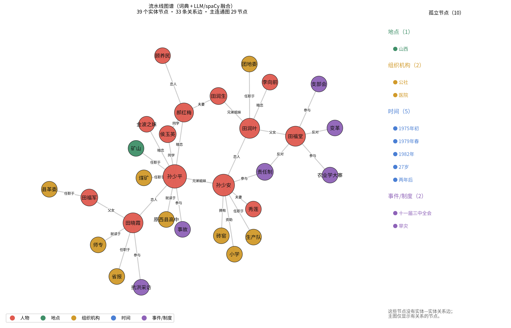
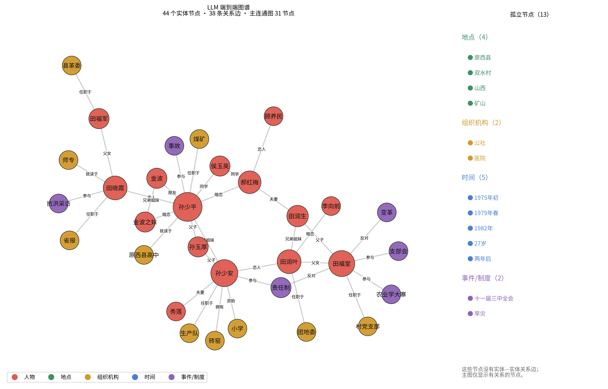

# 04 知识图谱：Neo4j 与 LLM 生成对比

## 1. 两条技术路线

| 路线 | 输入 | 构图方式 | 输出 |
|---|---|---|---|
| **Neo4j 路线** | 实体词典 + LLM/spaCy 融合三元组 + 文档 | 约束/索引 → `UNWIND` 批量导入 → Cypher 查询 | 图数据库（39 实体节点、33 关系边、3 文档节点、53 条 `MENTIONS`） |
| **LLM 路线** | 三篇梗概原文 | 单次端到端生成 JSON（实体 + 关系） | `outputs/kg_llm.json`（44 节点、38 边） |

> 严格说，Neo4j 不是“抽取模型”，而是图存储与查询引擎；这里的“Neo4j 生成图谱”指 **用 Neo4j 把抽取结果构建成可查询的知识图谱**。LLM 路线则是 **抽取与构图一体**。

## 2. Neo4j 数据模型与导入

### 节点

- `:Entity`，附加类型标签 `:PER`、`:LOC`、`:ORG`、`:TIME`、`:EVENT`；
- 属性：`name`（唯一约束）、`type`、`type_cn`、`aliases`、`description`、`frequency`、`docs`；
- `:Document`：`id`、`title`；`(Document)-[:MENTIONS {count}]->(Entity)` 记录文档提及。

### 关系

- 14 类业务关系直接作为关系类型（如 `:夫妻`、`:任职于`、`:参与`）；
- 属性：`sources`（LLM/spaCy）、`evidence`、`confidence`；
- 对称关系在导入前按规范名排序去重，避免双向重复边。

### 导入流程

```cypher
CREATE CONSTRAINT entity_name IF NOT EXISTS
ON (n:Entity) ASSERT n.name IS UNIQUE;

CREATE INDEX entity_type IF NOT EXISTS
FOR (n:Entity) ON (n.type);

UNWIND $rows AS row
MERGE (n:Entity:PER {name: row.name})
SET n.type = row.type, n.description = row.description, ...;
```

批量导入按类型/关系分组，每组一个 `UNWIND`，避免逐条事务开销。完整可执行脚本：`outputs/kg_pipeline.cypher`。

### 实测构建结果

| 指标 | 值 |
|---|---:|
| 导入耗时 | **2,529.5 ms** |
| 实体节点 | 39 |
| 关系边 | 33 |
| 文档节点 | 3 |
| `MENTIONS` 边 | 53 |
| 数据库占用 | 1,134,592 B（约 **1.08 MiB**） |
| 约束/索引 | 1 个唯一约束 + 1 个类型索引 + 1 个文档唯一约束 |

## 3. LLM 端到端图谱

- 生成方式：把三篇梗概与实体/关系 schema 一起给 LLM，要求一次输出 `nodes` + `edges` JSON；
- 生成耗时：**53,956 ms**（会话内端到端，含推理与 JSON 整理）；
- 规模：44 节点、38 边；
- 节点类型：PER 15、ORG 12、EVENT 8、TIME 5、LOC 4；
- 边类型：任职于 6、参与 5、父子 3、夫妻 3、恋人 3、暗恋 3、兄弟姐妹 3、同学 2、父女 2、就读于 2、朋友 2、反对 2、拥有 1、资助 1；
- 非法边（schema 外关系、自环、端点缺失）：**0**。

## 4. 质量对比（对同一金标准）

### 实体

| 指标 | Neo4j 路线（词典+融合） | LLM 端到端 |
|---|---:|---:|
| Precision | **1.0000** | 0.8864 |
| Recall | **1.0000** | **1.0000** |
| F1 | **1.0000** | 0.9398 |
| TP / FP / FN | 39 / 0 / 0 | 39 / 5 / 0 |

LLM 多出的 5 个实体：`原西县(LOC)`、`双水村(LOC)`、`孙玉厚(PER)`、`村党支部(ORG)`、`金波(PER)`。它们来自小说背景知识，不在三篇梗概的显式文本中——**覆盖更全，但不可溯源**。

### 关系（全局唯一 33 条）

| 指标 | Neo4j 路线（LLM∪spaCy 融合） | LLM 端到端 |
|---|---:|---:|
| Precision | **0.9697** | 0.8684 |
| Recall | 0.9697 | **1.0000** |
| F1 | **0.9697** | 0.9296 |
| TP / FP / FN | 32 / 1 / 1 | 33 / 5 / 0 |

- Neo4j 路线唯一错误：多 `孙少平-任职于-矿山`（地点当机构），漏 `田福堂-父子-田润生`（跨句回指）。
- LLM 路线召回 100%，但多出 5 条背景关系：`孙少安-父子-孙玉厚`、`孙少平-父子-孙玉厚`、`孙少平-朋友-金波`、`田福堂-任职于-村党支部`、`金波-兄弟姐妹-金波之妹`。这些关系在小说中成立，但在三段梗概中没有直接证据。

### 结构指标

| 指标 | Neo4j 路线 | LLM 路线 |
|---|---:|---:|
| 节点 | 39 | 44 |
| 关系边 | 33 | 38 |
| 密度 | 0.0223 | 0.0201 |
| 平均度 | 1.692 | 1.727 |
| 孤立节点 | 10 | 13 |

**共同问题**：时间、地点、事件节点大量孤立。Neo4j 路线孤立节点为 `1975年初、1979年春、1982年、27岁、两年后、公社、医院、十一届三中全会、山西、旱灾`；LLM 路线另有 `原西县、双水村、矿山` 也孤立。

原因不是抽取失败，而是 **schema 缺少时序/空间边**：没有 `发生于`（事件→时间）、`位于`（机构/地点→地点）等关系。下一步应扩展 schema，把这些节点接进主图，而不是继续堆实体。

## 5. 查询性能对比

在**同一台 2 核 / 3.9 GB 内存**的 Linux 云主机上，对同一组语义查询各跑 20 次（Neo4j 预热 3 次；JSON 预热 3 次、跑 100 次）：

| 查询 | 语义 | Neo4j 平均 / P95 (ms) | 流水线 JSON 平均 (ms) | LLM JSON 平均 (ms) |
|---|---|---:|---:|---:|
| q1 邻居 | 孙少平的直接关系 | **3.250 / 4.240** | 0.0005 | 0.0005 |
| q2 子女 | 田福堂的子女 | **3.732 / 7.219** | 0.0013 | 0.0010 |
| q3 事件参与者 | 所有 `人物-参与-事件` | **2.766 / 4.669** | 0.0024 | 0.0010 |
| q4 两跳 | 孙少平 2 跳内邻居 | **5.044 / 8.029** | 0.0039 | 0.0044 |
| q5 关系统计 | 各关系类型计数 | **2.639 / 4.201** | 0.0023 | 0.0026 |
| q6 最短路径 | 孙少平 → 田福军 | **2.837 / 3.051** | 0.0033 | 0.0037 |

### 如何解读这组数字

1. **不能直接说“JSON 比 Neo4j 快 10000 倍”**。Neo4j 的 3–5 ms 包含 Bolt 连接、会话、Cypher 解析/规划、事务与结果序列化；JSON 是 Python 进程内线性扫描，不经过网络与事务。两者不在同一层面。
2. **在本语料规模（39 节点 / 33 边）下，JSON 线性扫描确实更快**。任何数据结构在 33 条边上都不需要索引。
3. **Neo4j 的价值在规模与复杂度**：名称索引把 `MATCH (n {name:$name})` 从 O(N) 降到近似 O(log N)；Cypher 支持变长路径、最短路径、聚合、约束与并发事务，这些是手写 JSON 扫描难以维护的。
4. **LLM JSON 与流水线 JSON 查询延迟几乎相同**，因为都是 38 条边左右的进程内扫描；差异在数据规模与语义质量，不在查询引擎。

### 复杂度视角

| 操作 | JSON 线性扫描 | Neo4j（有索引） |
|---|---|---|
| 按名称找节点 | O(N) | O(log N) |
| 查直接邻居 | O(E) | O(degree) |
| 两跳邻居 | O(E × 平均度) | O(两跳邻域) |
| 最短路径 | BFS O(N+E) | 双向 BFS + 索引 |
| 并发写入 | 需自行加锁 | 事务/锁管理 |
| Schema 约束 | 需自行校验 | 唯一约束/类型索引 |

在本项目规模，Neo4j 的固定开销大于收益；当节点数到 10^4–10^5、或需要多用户并发与增量更新时，Neo4j 的优势才会显现。

### 查询结果校验

- q2 只返回 **1 个子女（田润叶）**，而不是金标准中的 2 个；原因是融合图谱漏了 `田福堂-父子-田润生`。这说明图查询结果会直接暴露抽取漏项。
- q6 返回 **2 跳**：`孙少平 —(恋人)— 田晓霞 —(父女)— 田福军`，与文本一致。

## 6. 构建/存储/可维护性对比

| 维度 | Neo4j 路线 | LLM 路线 |
|---|---|---|
| 构图耗时 | 导入 **3.97 s**；上游抽取另计 | **53.96 s** 端到端 |
| 端到端离线成本 | BERT NER 378.59 s + BiLSTM 30.09 s + spaCy + 导入 ≈ **6.9 min**（监督路线） | **≈ 54 s**（单次生成） |
| 存储 | 1.00 MB（含事务日志/系统开销） | 17 KB JSON |
| 增量更新 | 可按实体/关系 `MERGE`，支持事务 | 需重新生成整图，难以差量合并 |
| Schema 约束 | 唯一约束、类型索引、关系方向可校验 | 依赖 Prompt，可能类型漂移 |
| 可解释性 | 每条边有 `sources/evidence/confidence` | 有 evidence 字段，但可能夹带背景知识 |
| 查询能力 | Cypher：路径、聚合、模式匹配 | 手写遍历，复杂查询开发成本高 |
| 可视化 | Neo4j Browser / Bloom | 需额外渲染 |
| 适用场景 | 生产级存储、查询、增量维护 | 冷启动、小规模、快速原型、背景补全 |

## 7. 图谱可视化

流水线图谱（主连通图 29 节点，右侧列出 10 个孤立节点）：



LLM 端到端图谱（主连通图 31 节点，右侧列出 13 个孤立节点）：



## 8. 结论与建议

1. **质量上**：Neo4j 路线（词典 + LLM/spaCy 融合）实体 F1=1.0、关系 F1=0.9697，**精度更高、可溯源**；LLM 端到端实体 F1=0.9398、关系 F1=0.9296，**召回更高但夹带 5 条背景知识**。
2. **性能上**：小图（39 节点）Neo4j 查询 3–5 ms，JSON 进程内 0.0005–0.0046 ms；**小图 JSON 更快，大图 Neo4j 更稳**。构图时间 LLM 54 s vs Neo4j 导入 2.5 s，但 Neo4j 依赖上游抽取。
3. **最佳实践是混合**：
   - 用 LLM 做冷启动抽取与背景补全；
   - 用词典/规则做类型与方向校验；
   - 用 Neo4j 做持久化、索引、路径查询与增量更新；
   - 对 LLM 多出的节点/边标记 `source=LLM_background`，要求人工确认后才能进入生产图。
4. **下一步**：扩展 `发生于`、`位于`、`所属` 等时空/层级关系，把当前 10–13 个孤立的时间/地点/事件节点接入主图；再在 10^4 节点级做查询压测，验证 Neo4j 的规模优势。

> 可执行 Cypher：`outputs/kg_pipeline.cypher`；机器可读指标：`outputs/kg_metrics.json`；LLM 图：`outputs/kg_llm.json`。
